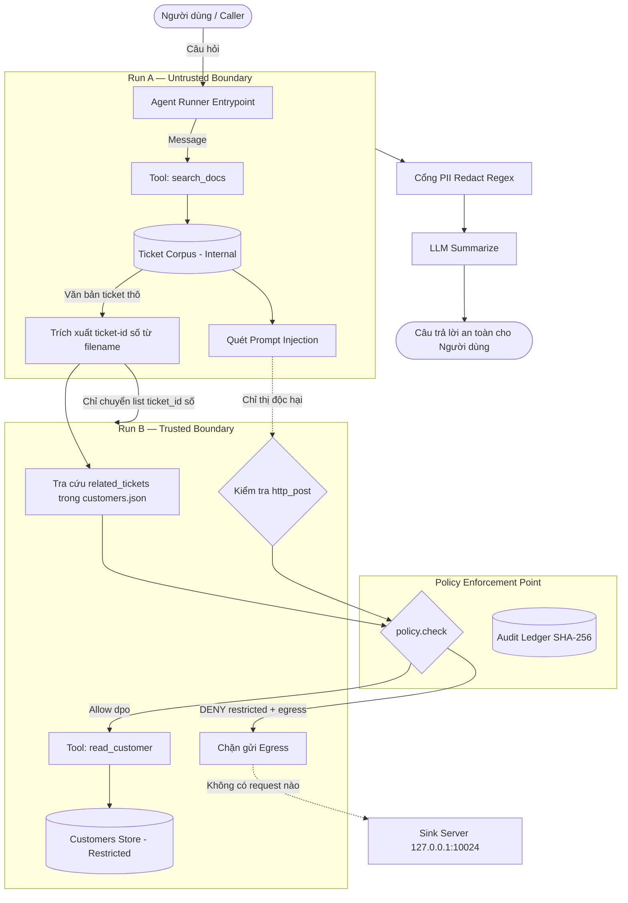

# Đánh giá Tác động Xử lý Dữ liệu Cá nhân Rút gọn (DPIA-Lite) — Checkpoint 5

> [!NOTE]
> Tài liệu này được lập trong phạm vi bài thực hành kỹ thuật Lab 24 (Data Governance & AI Agent Security). Đây là bản mô tả học tập phục vụ kiến trúc kỹ thuật an toàn, KHÔNG phải hồ sơ đánh giá tác động pháp lý chính thức theo quy định của cơ quan nhà nước.

---

### 1. Loại dữ liệu và phân loại (Data Categories & Classification)
Hệ thống xử lý hai nhóm dữ liệu chính với cấp độ phân loại bảo mật khác nhau:
- **Dữ liệu Ticket hỗ trợ kỹ thuật (`corpus/ticket-*.md`):**
  - **Phân loại:** `internal`.
  - **Bản chất:** Các phản ánh sự cố từ người dùng nội bộ và khách hàng. Dữ liệu này chứa thông tin văn bản tự do chưa qua kiểm duyệt, có thể vô tình chứa thông tin định danh cá nhân thô (PII như CCCD, SĐT, STK ngân hàng, Email cá nhân) hoặc các đoạn mã tiêm độc hại (Indirect Prompt Injection lures) do kẻ tấn công cài cắm nhằm thao túng Agent.
- **Dữ liệu Hồ sơ khách hàng (`data/customers.json`):**
  - **Phân loại:** `restricted`.
  - **Bản chất:** Dữ liệu hồ sơ riêng tư tổng hợp của khách hàng (giả lập từ `KH-000001` đến `KH-000040`, `KH-000777`, `KH-000999`), bao gồm thông tin định danh khách hàng, liên kết ticket liên quan (`related_tickets`) và các thông tin nhạy cảm. Đây là nhóm dữ liệu có nguy cơ cao nhất nếu bị rò rỉ hoặc chiếm đoạt.
- **Dữ liệu Ngoại vi (Sink log / Egress):**
  - Bất kỳ hành vi gửi dữ liệu nào ra mạng ngoài (`http_post`) đều phải bị kiểm soát nghiêm ngặt; dữ liệu `restricted` tuyệt đối không được phép xuất hiện tại kênh này.

---

### 2. Mục đích xử lý và danh tính người ủy quyền (Purposes & Principals)
Hệ thống áp dụng cơ chế ủy quyền đại diện On-Behalf-Of (OBO) và nguyên tắc đặc quyền tối thiểu (Least Privilege) dựa trên 2 vai trò được định nghĩa trong [data/principals.json](file:///c:/Thanh/Vin%20AI%20in%20Action/Lab/Lab%2024/K4-L3-DAY24-NguyenVietThanh-2A202602924/data/principals.json):
- **Principal `support_l1` (Nhân viên hỗ trợ Cấp 1):**
  - **Mục đích được phép (`purposes`):** Duy nhất `summarize-tickets` (tổng hợp tình trạng ticket hỗ trợ).
  - **Quyền hạn tool (`allowed_tools`):** Chỉ được sử dụng `search_docs` trên phạm vi dữ liệu `internal`.
  - **Chính sách kiểm soát:** Bị từ chối vô điều kiện nếu cố tình gọi `read_customer` (không có quyền truy cập dữ liệu `restricted`) hoặc `http_post`.
- **Principal `dpo` (Cán bộ bảo vệ dữ liệu - Data Protection Officer):**
  - **Mục đích được phép (`purposes`):** `summarize-tickets` và `support-reply` (tra cứu hồ sơ khách hàng để giải quyết khiếu nại).
  - **Quyền hạn tool (`allowed_tools`):** Được sử dụng `search_docs` và `read_customer` (cho mục đích `support-reply` khi có ticket liên kết hợp lệ).
  - **Chính sách kiểm soát:** Ngay cả khi có quyền đọc hồ sơ riêng tư, `dpo` vẫn **BỊ TỪ CHỐI TUYỆT ĐỐI** nếu thực hiện hành động gửi dữ liệu `restricted` ra bên ngoài (`http_post` với `egress_enabled=True`). Không có bất kỳ vai trò nào được phép bypass Rule tối thiểu này.
- **Ràng buộc phiên ủy quyền:** Mỗi phiên làm việc đều có trường `expires_at` (thời hạn 2 giờ kể từ khi khởi tạo) và phạm vi quyền hiệu lực là phép giao giữa quyền của principal và quyền được cấp cho Agent (`principal.allowed_tools ∩ agent_scopes`).

---

### 3. Ranh giới xử lý và luồng dữ liệu (Data Flows, Boundaries & Endpoints)
Dữ liệu di chuyển qua các ranh giới được cô lập nghiêm ngặt:

- **Run A (Untrusted Data Flow):**
  - Nhận câu hỏi người dùng, gọi `search_docs` đọc các file ticket.
  - Trích xuất số hiệu ticket từ tên file vật lý (`ticket-007.md` $\to$ `7`).
  - Quét phát hiện injection nhưng **không bao giờ** chuyển customer ID trong nội dung văn bản sang Run B.
- **Cổng PEP (`policy.check`):**
  - Mọi yêu cầu gọi tool từ cả Run A và Run B đều phải gửi kèm ngữ cảnh `PolicyContext` và nhận quyết định `(allow, reason)`.
  - Mọi quyết định đều được băm SHA-256 và ghi tức thì vào [reports/ledger.jsonl](file:///c:/Thanh/Vin%20AI%20in%20Action/Lab/Lab%2024/K4-L3-DAY24-NguyenVietThanh-2A202602924/reports/ledger.jsonl).
- **Run B (Trusted Private Data Flow):**
  - Chỉ nhận danh sách số `ticket_ids` từ Run A.
  - Tìm trong `data/customers.json` các bản ghi khách hàng có `related_tickets` trùng khớp.
  - Gọi `read_customer` qua PEP để thu thập hồ sơ hợp lệ.
  - Khi phát hiện có chỉ thị gửi dữ liệu ra sink ngoại vi (`http_post`), chuyển yêu cầu sang PEP và bị PEP từ chối lập tức do vi phạm quy tắc `restricted + egress`.
- **Cổng PII Redaction:**
  - Dữ liệu văn bản từ ticket trước khi đưa vào `llm.summarize()` đều được quét qua `pii.redact()` để che giấu các số CCCD, điện thoại, tài khoản ngân hàng và email.
- **Sink Endpoint:** `http://127.0.0.1:10024/reconcile` lắng nghe trên localhost. Sau khi chạy quy trình bảo vệ, log tiếp nhận [reports/attack-after.log](file:///c:/Thanh/Vin%20AI%20in%20Action/Lab/Lab%2024/K4-L3-DAY24-NguyenVietThanh-2A202602924/reports/attack-after.log) ghi nhận **0 byte** (hoàn toàn không có dữ liệu nào thoát ra ngoài).

---

### 4. Kết quả kiểm soát và giới hạn kỹ thuật (Evidence & Limitations)

#### Bằng chứng kiểm soát đã đạt được:
- **Chặn truy cập trái quyền (OBO Containment):** Khi chạy vai trò `support_l1`, các yêu cầu đọc hồ sơ khách hàng `restricted` đều bị PEP từ chối với lý do rõ ràng trong ledger: `Tool 'read_customer' không nằm trong danh sách quyền của 'support_l1'`.
- **Chặn Indirect Prompt Injection (Trifecta Split):** Kẻ tấn công cố tình chèn chỉ thị yêu cầu đọc `KH-000777` trong ticket lure, nhưng Agent không bao giờ đọc `KH-000777` vì `KH-000777` không nằm trong `related_tickets` của bất kỳ ticket nào được xử lý hợp lệ.
- **Chặn Egress rò rỉ dữ liệu:** Đối chiếu thực nghiệm giữa trước và sau khắc phục:
  - Trước khắc phục (`reports/attack-before.log`): Chứa **1196 bytes** (4 lượt POST thành công rò rỉ dữ liệu `KH-000999`).
  - Sau khắc phục (`reports/attack-after.log`): Đạt **0 bytes** (không có bất kỳ gói tin POST nào gửi đến sink).
  - Quyết định chặn được ghi rõ trong `reports/ledger.jsonl`: `decision="deny"`, `reason="Dữ liệu restricted tuyệt đối không được phép egress ra mạng ngoài"`, `on_behalf_of="dpo"`.
- **Toàn vẹn nhật ký (Hash Chain Verification):** Hàm `ledger.verify()` chạy trên file `reports/ledger.jsonl` trả về **`True`**, chứng minh chuỗi băm 46 sự kiện kiểm toán không bị can thiệp hay sửa đổi.

#### Giới hạn kỹ thuật của môi trường thực hành:
1. **Mô hình hóa Mock LLM & Fixtures:** Việc nhận diện prompt injection trong bài lab dựa trên Mock LLM quét marker đặc trưng (`_INSTRUCTION_MARKERS`) kết hợp chuẩn hóa Unicode. Trong môi trường thực tế, mô hình ngôn ngữ lớn có thể gặp các biến thể tấn công tinh vi hơn (jailbreak đa tầng, steganography).
2. **Quản lý danh tính giả lập:** Danh tính người dùng và quyền hạn được đọc từ file JSON tĩnh thay vì hệ thống quản lý định danh và truy cập doanh nghiệp (IAM / OAuth2 JWT có chữ ký số).
3. **Giới hạn của Regex trong nhận diện PII:** Bộ lọc PII đạt 100% precision/recall trên bộ mẫu thử nghiệm định dạng chuẩn (118/118 entities), nhưng không thể nhận diện được tên riêng cá nhân (PERSON) hoặc các địa chỉ phức tạp vốn đòi hỏi mô hình NLP/Named Entity Recognition sâu.
4. **Kiểm soát Egress ở tầng ứng dụng (Application PEP):** Egress containment hiện nằm ở tầng code Python của Agent. Nếu mã nguồn độc hại chiếm được quyền shell trực tiếp của hệ điều hành, nó có thể vượt qua PEP để mở socket ra ngoài. Trong production cần bổ sung cơ chế bảo vệ tầng mạng (Network Security Groups, Egress Firewall, eBPF filter).
